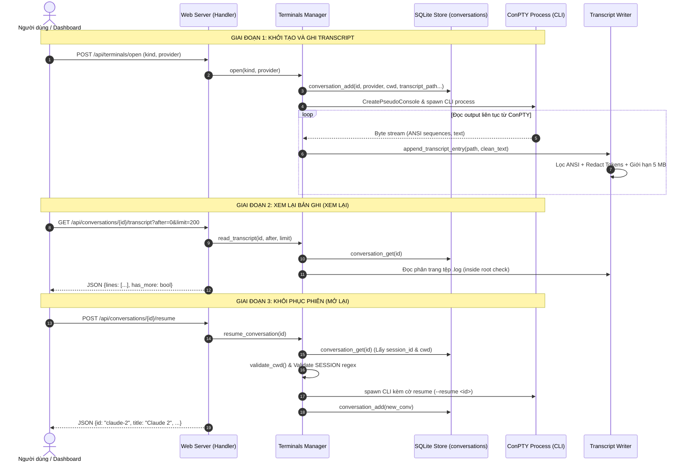

# Kiến Trúc Kỹ Thuật: Tính Năng Chat History & Session Resume

Tài liệu này mô tả chi tiết thiết kế kiến trúc, cấu trúc cơ sở dữ liệu, các luồng tương tác, và cơ chế an ninh của hệ thống lưu trữ lịch sử hội thoại và khôi phục phiên trong Agent Orchestrator.

---

## 1. Thiết Kế Kiến Trúc 2 Tầng (Two-Tier Architecture)

Để giải quyết bài toán quản lý lịch sử cho nhiều loại CLI khác nhau (mỗi công cụ có định dạng lưu trữ và cơ chế bộ nhớ riêng), Orchestrator áp dụng mô hình phân tầng:

```
┌────────────────────────────────────────────────────────────────────────┐
│                        AGENT ORCHESTRATOR DASHBOARD                    │
└────────────────────────────────────┬───────────────────────────────────┘
                                     │
       ┌─────────────────────────────┴─────────────────────────────┐
       ▼                                                           ▼
┌───────────────────────────────┐           ┌────────────────────────────────┐
│   LỚP A: RESUME NGỮ CẢNH THẬT  │           │   LỚP B: BẢN GHI MÀN HÌNH PTY  │
│      (Official CLI State)     │           │         (Transcript Log)       │
├───────────────────────────────┤           ├────────────────────────────────┤
│ • Claude Code:                │           │ • Ghi lại 100% output xterm    │
│   claude --resume <session_id>│           │ • Hook trực tiếp từ ConPTY     │
│ • OpenAI Codex:               │           │ • Lọc ANSI escape sequences    │
│   codex resume <session_id>   │           │ • Che giấu tokens / secrets    │
│ • Tiếp tục hội thoại với LLM  │           │ • Đọc chỉ đọc (Pagination API) │
│ • Giữ nguyên ngữ cảnh mô hình │           │ • Áp dụng cho MỌI agent (kể cả │
│   và context window           │           │   Antigravity / Worker tasks)  │
└───────────────────────────────┘           └────────────────────────────────┘
```

- **Lớp A — Khôi phục ngữ cảnh thật (Context Resume)**: Dành cho các CLI hỗ trợ phiên làm việc bền vững. Cho phép người dùng hoặc hệ thống chạy lại tiến trình CLI với cờ khôi phục chính thức, nạp lại toàn bộ lịch sử tin nhắn đã trao đổi với mô hình LLM.
- **Lớp B — Bản ghi màn hình chỉ đọc (Screen Transcript)**: Độc lập với cơ chế bên trong của CLI. ConPTY hook ghi nhận mọi luồng byte hiển thị ra màn hình terminal, làm sạch mã điều khiển, che giấu dữ liệu nhạy cảm và lưu trữ nối tiếp thành các file log văn bản thuần có gắn mốc thời gian.

---

## 2. Sơ Đồ Tuần Tự (Sequence Diagram)



---

## 3. Cấu Trúc Cơ Sở Dữ Liệu: Bảng `conversations`

Cơ sở dữ liệu SQLite (`queue.sqlite3`) quản lý bảng `conversations` với schema:

```sql
CREATE TABLE IF NOT EXISTS conversations(
    id TEXT PRIMARY KEY,               -- Định danh duy nhất (UUID hex)
    terminal_key TEXT,                 -- Khóa phiên terminal (ví dụ: 'claude-1', 'agent0')
    provider TEXT NOT NULL,            -- 'claude' | 'codex' | 'agy' | 'agent0'
    agent_n INTEGER,                   -- Số hiệu agent tương ứng (1, 2, ...)
    kind TEXT NOT NULL,                -- 'agent' | 'worker' | 'agent0'
    cwd TEXT NOT NULL,                 -- Thư mục làm việc tại thời điểm chạy
    task_id TEXT,                      -- Mã task liên kết (nếu là worker trong worktree)
    session_id TEXT,                   -- ID phiên chính thức của CLI dùng để resume
    title TEXT NOT NULL,               -- Tiêu đề tóm tắt phiên
    started TEXT NOT NULL,             -- ISO-8601 UTC timestamp bắt đầu
    last_active TEXT NOT NULL,         -- ISO-8601 UTC timestamp hoạt động gần nhất
    status TEXT NOT NULL,              -- 'active' | 'closed' | 'failed'
    transcript_path TEXT NOT NULL      -- Đường dẫn tuyệt đối tới file transcript .log
);

CREATE INDEX IF NOT EXISTS idx_conversations_started ON conversations(started DESC);
CREATE INDEX IF NOT EXISTS idx_conversations_provider ON conversations(provider);
```

### Phương thức truy xuất (`Store`):
- `conversation_add(conv: dict)`: Thêm mới bản ghi phiên hội thoại.
- `conversation_get(conv_id: str)`: Lấy thông tin chi tiết một phiên; raise `OrchError` nếu không tìm thấy.
- `conversation_update(conv_id: str, **fields)`: Cập nhật động trạng thái, tiêu đề, `last_active`, hoặc `session_id`.
- `conversation_list(limit=50, provider=None, q=None)`: Tra cứu lịch sử kết hợp phân trang, lọc theo nhà cung cấp và tìm kiếm toàn văn theo tiêu đề, task ID, cwd hoặc ID.

---

## 4. Cơ Chế Phát Hiện Session ID

Mỗi CLI có cách quản lý session ID khác nhau. Hệ thống hiện thực các cơ chế trích xuất chuyên biệt:

### 4.1. Claude Code
- Khi khởi tạo phiên mới, Orchestrator sinh một UUID v4 ngẫu nhiên và truyền cờ tường minh:
  ```bash
  claude --session-id <uuid> ...
  ```
- Khi khôi phục phiên (Resume), Orchestrator khởi chạy:
  ```bash
  claude --resume <uuid> ...
  ```
  Nhờ chỉ định `--session-id` từ đầu, việc liên kết giữa bảng `conversations` và Claude Code là xác định (deterministic) 100%, không cần quét log hay phụ thuộc vào thời điểm hoàn tất lượt chạy.

### 4.2. OpenAI Codex (Async Rollout Scan & Retry Backoff)
Codex lưu trữ phiên trong các file JSONL tại `~/.codex/sessions/<YYYY>/<MM>/<DD>/rollout-*.jsonl`. Vì file này được tạo bất đồng bộ sau khi tiến trình khởi động, hàm `scan_codex_session()` thực hiện:
1. **Duyệt đa ngày và đa múi giờ**: Quét các thư mục của ngày hôm qua, hôm nay và ngày mai theo cả giờ hệ thống cục bộ (`datetime.now()`) và giờ quốc tế UTC (`timezone.utc`).
2. **Lọc thông minh**:
   - Chỉ xét các file có `st_mtime >= started_time - 5.0s`.
   - Đọc dòng đầu tiên để lấy đối tượng `session_meta`.
   - Kiểm tra chuẩn hóa đường dẫn `payload.cwd == target_cwd`.
3. **Chọn file tối ưu**: Nếu có nhiều file khớp cwd, sắp xếp theo `st_mtime` giảm dần để chọn file mới nhất gần thời điểm bắt đầu nhất.
4. **Retry Backoff**: Nếu chưa tìm thấy, hàm thử lại với chuỗi chờ lũy tiến `[200ms, 400ms, 800ms]` trong giới hạn timeout.

### 4.3. Google Antigravity (`agy`)
Antigravity CLI hiện tại được hỗ trợ đầy đủ ở **Lớp B** (Ghi và hiển thị transcript). Bản ghi màn hình lưu trữ 100% nội dung qua PTY hook. Khi CLI hỗ trợ cờ lưu phiên chính thức, cờ `--conversation <id>` sẽ được liên kết vào Lớp A.

---

## 5. Cơ Chế An Toàn và Giới Hạn Tài Nguyên

1. **Giới hạn tệp tin (File Limit)**: Mỗi file transcript tối đa **5 MB**. Khi chạm ngưỡng, hàm `truncate_file_head` cắt tỉa phần đầu file, bảo toàn 4 MB dữ liệu gần nhất theo ranh giới dòng (`\n`).
2. **Giới hạn thư mục (Directory Limit)**: Tổng dung lượng thư mục transcripts không vượt quá **100 MB**. Hàm `prune_transcripts_dir` tự động thu hồi các file cũ nhất dựa trên `st_mtime`.
3. **Che giấu chuỗi nhạy cảm (Token Redaction)**: Tự động xóa sạch mã ANSI escape và làm mờ các token `sk-ant-*`, `sk-*`, `ghp_*`, `Bearer ...` trước khi ghi đĩa.
4. **Phân quyền và bảo vệ API**:
   - Tất cả endpoint `/api/conversations*` yêu cầu Bearer token xác thực và Origin hợp lệ.
   - Tuyệt đối cách ly Agent 0: MCP bridge không có quyền gọi API resume.
   - Cấm UNC path và symlink; kiểm tra CWD nghiêm ngặt qua danh sách repo hoặc worktree hợp lệ.
